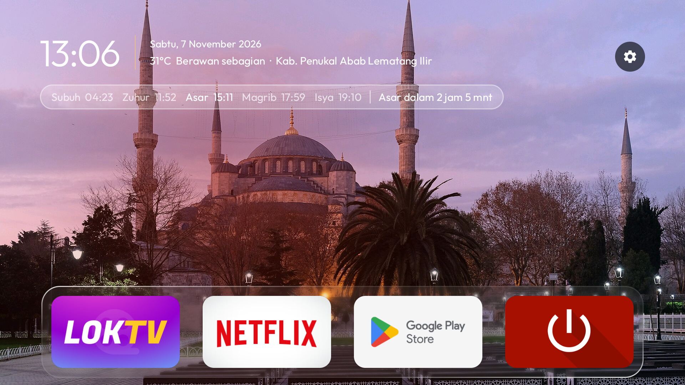

# Clear TV Islamic

<p><a href="README.md">English</a> · <b>Bahasa Indonesia</b> · <a href="docs/INSTALL.md">Panduan pemasangan</a> · <a href="docs/INSTALL.id.md">Panduan instalasi</a></p>

**Layar utama yang ringan dan nyaman untuk Android TV dan Google TV, dengan jadwal salat Indonesia, cuaca lokal,
azan, ayat Al-Qur'an, dan foto masjid online yang berganti di latar Home.**

Clear TV Islamic mengganti layar utama TV yang ramai dengan deretan aplikasi horizontal yang mudah dijelajahi memakai
remote, animasi fokus yang halus, bunyi navigasi, dan dock kaca. Jadwal salat Indonesia dan cuaca lokal mengikuti
lokasi TV. Foto masjid berganti di belakang Home setiap tiga menit saat TV terhubung ke internet. Screensaver Islam
memiliki koleksi foto masjid yang diunduh tersendiri, jadwal salat, tanggal Hijriah, dan ayat Al-Qur'an. Alat
penyiapan opsional dapat mengurangi aplikasi bawaan tanpa akses root. Home tidak memiliki wallpaper offline bawaan;
gambar tema lokal tersedia jika Anda ingin memakai wallpaper yang tidak bergantung pada koneksi internet.

- **Jadwal salat Indonesia** dari myQuran, dipilih otomatis berdasarkan lokasi TV, dengan salat berikutnya yang
  ditandai dan hitung mundur langsung.
- **Cuaca di samping jam**, menampilkan suhu, kondisi cuaca, dan kota yang terdeteksi.
- **Azan** pada setiap waktu salat, bahkan saat Anda menonton YouTube atau Netflix: layar penuh di Home, atau pita
  di bagian bawah layar saat aplikasi lain terbuka. Anda dapat memilih rekaman azan yang digunakan (rekaman Subuh
  berbeda).
- **Screensaver Islam** dengan jam emas, kartu jadwal salat hari ini, dan ayat Al-Qur'an yang berganti.
- **Foto masjid online untuk Home** dari daftar pilihan `themes/islamik/masjid.json`, berganti setiap tiga menit.
  Foto disimpan sementara di memori, bukan secara lokal. APK tidak memiliki wallpaper offline bawaan; screensaver
  mengunduh koleksi foto masjidnya sendiri ke penyimpanan lokal.
- **Ringan dan rapi**: iklan, pelacakan, dan aplikasi bawaan yang tidak diperlukan dinonaktifkan; TV juga
  membersihkan cache-nya sendiri setiap 15 hari.
- **Umpan balik navigasi**: bunyi singkat SoundPool saat fokus berpindah antar aplikasi. Tema Islam menampilkan dock
  kaca dan menyembunyikan tombol Wi-Fi serta Inputs.
- **Satu deretan aplikasi horizontal**: jelajahi aplikasi terpasang dengan tombol Kiri dan Kanan; tombol Atas
  kembali ke bilah atas. Aplikasi favorit berada di awal deretan, ubin yang dipilih membesar, dan namanya muncul di
  atas ubin.

**Baru menggunakan ini? Ikuti [panduan instalasi langkah demi langkah](docs/INSTALL.id.md)**: tanpa coding, tanpa
Android SDK, sekitar 30 menit. Dibangun di atas [CleanYourTV](https://github.com/Gathin23/cleanyourtv) karya
Gathin (MIT).

<sub>Jadwal salat berasal dari API myQuran (Kemenag RI). Data cuaca berasal dari Open-Meteo.</sub>

## Yang Anda dapatkan

- **Membersihkan cache secara otomatis.** Setiap 15 hari, saat Home tidak aktif digunakan, TV membersihkan cache
  aplikasi. Play Store dapat meninggalkan banyak berkas unduhan sementara yang membuat aplikasi hanya menampilkan
  layar kosong. Tidak perlu komputer; akun dan data aplikasi tidak disentuh. TV akan meminta izin satu kali.
- **Efek kaca.** Tray dock, tombol di bilah atas, dan menu menampilkan gambar di belakangnya dengan efek buram serta
  garis tepi yang berkilau. Android 10 belum memiliki efek buram langsung, jadi gambar diburamkan setiap kali
  berubah dan kaca menampilkan potongan gambar tersebut.
- **Sorotan yang meluncur.** Di antara aplikasi, sorotan berupa panel kaca dengan bayangan aplikasi; di bilah atas
  dan menu, warnanya gelap. Sorotan bergeser dan berubah bentuk dengan halus, tanpa melompat.
- **Label aplikasi yang jelas.** Nama aplikasi yang dipilih muncul di bagian atas ubinnya; label aplikasi lain dan
  keterangan foto masjid disembunyikan di Home.
- **Atur aplikasi memakai remote.** Tahan OK pada sebuah aplikasi untuk membuka menu kaca berisi **Pindahkan** dan
  **Info aplikasi**. Saat dipindahkan, ubin bergoyang; tombol panah menggesernya, termasuk keluar atau masuk dock,
  sementara aplikasi lain memberi ruang. Tekan OK untuk meletakkannya. Urutan tersimpan, dan aplikasi baru
  ditambahkan di bagian akhir.
- **Sembunyikan aplikasi tanpa menghapusnya.** Tahan OK pada aplikasi, lalu pilih **Sembunyikan aplikasi**. Untuk
  menampilkannya kembali, tahan OK pada Setelan, buka **Aplikasi tersembunyi**, lalu pilih aplikasi yang ingin
  ditampilkan.
- **Kembali ke posisi sebelumnya.** Saat kembali dari aplikasi, aplikasi yang terakhir dipilih tetap tersorot;
  menekan Home saat berada di Home akan memilih aplikasi pertama. Jika Android menutup Home untuk mengosongkan
  memori, Home kembali utuh dalam satu bingkai tanpa layar hitam atau dock yang belum selesai dimuat.
- **Screensaver jam.** Dial analog abu-abu dengan jarum detik kuning-oranye yang bergerak, waktu dan tanggal di
  bawahnya, serta posisi yang bergeser sedikit setiap menit untuk mencegah burn-in.
- **Gunakan wallpaper sendiri** dengan mengatur `"masjid_home": false`: tambahkan `wallpaper.jpg` atau gambar ke
  folder `wallpapers/` di dalam tema. Launcher mengecilkan gambar di thread latar belakang dan dapat menggantinya
  sesuai interval tema.

| | |
|---|---|
|  |  |
| *Menu Inputs dengan efek kaca* | *Screensaver Islam* |
|  |  |
| *Layar azan saat TV berada di Home* | *Azan di atas aplikasi lain, termasuk YouTube atau Netflix* |

Tetap ringan: di Xiaomi Mi TV dengan RAM 1,8 GB, launcher menggunakan sekitar 80–100 MB dan stabil selama berjam-jam.
Pada satu waktu hanya satu bitmap wallpaper yang disimpan di memori. Tidak ada proses yang berjalan saat Anda berada
di dalam aplikasi lain, kecuali azan pada waktu salat.

## Penyiapan

**Cara mudah tanpa coding:** [panduan instalasi langkah demi langkah](docs/INSTALL.id.md) memasang APK siap pakai
`dist/clear-tv-islamic.apk`, jadi Anda hanya memerlukan Python, bukan Java atau Android SDK.

**Menggunakan agen coding AI** (Claude Code, Codex, Cursor, Copilot, dan lainnya)? Arahkan agen ke repositori ini
dan minta untuk menyiapkan TV Anda. [AGENTS.md](AGENTS.md) menjelaskan cara melakukannya dengan aman di Android TV
atau Google TV: agen terlebih dahulu memastikan versi Clear TV Islamic yang cocok untuk TV Anda (launcher Android,
aplikasi LG webOS, atau tidak didukung di Samsung dan Roku), lalu meminta izin sebelum setiap perubahan,
mencadangkan data lebih dahulu, tidak pernah menghapus aplikasi, dan memeriksa setiap langkah bersama Anda.

Panduan lengkap untuk mengurangi aplikasi bawaan dan memasang launcher tersedia di
[docs/CLEANYOURTV-README.md](docs/CLEANYOURTV-README.md). [PROMPT.md](PROMPT.md) berisi instruksi untuk agen coding
yang dapat melakukannya untuk Anda. Ringkasnya:

```bash
python3 -m venv tools/venv && tools/venv/bin/pip install -r tools/requirements.txt
export TV_HOST=192.168.1.50                                   # alamat IP TV Anda
tools/disable.sh examples/<tv-anda>/debloat.txt                # kurangi aplikasi bawaan
launcher/build-and-install.sh                                 # bangun launcher dan jadikan Home
# atau, tanpa membangun: APK=dist/clear-tv-islamic.apk launcher/build-and-install.sh
tools/theme.sh themes/<tema-anda>                              # kirim pengaturan dan wallpaper
```

Clear TV Islamic membersihkan cache TV secara otomatis setiap 15 hari ([caranya](docs/cache-clean.md)). Untuk
membersihkan beberapa TV dari satu komputer, [`tools/cache-clean.sh`](docs/cache-clean.md) mencari TV di jaringan
Anda dan menghapus cache-nya tanpa menyentuh akun atau data aplikasi.

## Jadwal salat dan azan


- **Jadwal salat di Home:** baris kaca di bawah jam menampilkan lima waktu salat hari ini (Subuh, Zuhur, Asar,
  Magrib, Isya), salat berikutnya yang ditandai, dan hitung mundur ("Asar dalam 12 mnt"). Kota ditentukan dari
  lokasi Android saat ini; jadwal harian berasal dari [API myQuran](https://api.myquran.com/doc), bersumber dari
  Kemenag RI, dan disimpan di TV.
- **Cuaca dan lokasi:** suhu dan kondisi terkini dari [Open-Meteo](https://open-meteo.com/en/docs), di samping
  tanggal dan nama kota. Layanan lokasi Android di TV menentukan lokasi saat Home terbuka.
- **Screensaver Islam:** jam emas, tanggal Indonesia dan Hijriah, kartu jadwal salat dengan salat berikutnya berbingkai
  emas, serta ayat Al-Qur'an beserta terjemahannya yang berganti setiap tiga menit. Teks Arab menggunakan Rasm
  Utsmani dan terjemahan Kementerian Agama RI (Kemenag RI), melalui quran.com
  (`launcher/app/src/main/res/raw/ayat.json`).
- **Foto masjid:** Home mengganti foto dari [themes/islamik/masjid.json](themes/islamik/masjid.json) setiap tiga
  menit. Foto Home dari internet hanya disimpan di memori, bukan penyimpanan lokal; APK tidak memiliki wallpaper
  offline bawaan. Screensaver memiliki koleksi foto tersendiri yang diunduh. Kredit dan lisensi foto tercantum di
  daftar tersebut.
- **Azan:** pada setiap waktu salat, di screensaver atau Home, layar azan muncul dan memutar `azan.mp3`
  (`azan-subuh.mp3` untuk Subuh). **Di aplikasi lain** (YouTube, Netflix, TV Langsung), pita muncul dari bagian
  bawah sepertiga layar, menampilkan nama salat, menjeda video di belakangnya, lalu memutar azan. Tekan tombol apa
  saja di remote untuk menghentikannya. Atur `"azan_over_apps": false` agar azan hanya muncul di Home dan screensaver.

**Cara mengaktifkan:** pasang launcher seperti biasa, lalu buat folder tema dengan `config.json`.
[themes/islamik](themes/islamik/config.json) siap disalin:

```json
{
  "auto_location": true,
  "weather": true,
  "download_masjid": true,
  "download_azan": true,
  "show_network_pill": false,
  "show_inputs": false,
  "show_dock_tray": true,
  "azan": true
}
```

Launcher menggunakan lokasi Android TV untuk menentukan kota secara otomatis. Tema [themes/islamik](themes/islamik)
menyertakan azan (`azan.mp3`, oleh Ustaz Asri Ibrahim dari Rabbani) dan azan Subuh (`azan-subuh.mp3`). Anda dapat
menggantinya dengan rekaman sendiri menggunakan nama file yang sama. Jika salah satu file audio tidak ada,
`download_azan` akan mengunduh rekaman bawaan dan menyimpannya di TV; file khusus Anda tidak ditimpa. Kemudian kirim
tema ke TV:

```bash
TV_HOST=<ip tv> tools/theme.sh <folder tema>
```

Tanpa file audio, layar azan tetap muncul tanpa suara selama 90 detik. Atur `"azan": false` untuk mematikan azan.
Atur `"auto_location": false` untuk menonaktifkan jadwal salat berbasis lokasi, atau `"weather": false` untuk
menyembunyikan cuaca.

## TV yang didukung

Android TV dan Google TV dengan Android 8 atau lebih baru, baik yang terpasang di TV maupun di perangkat yang
disambungkan ke TV. [docs/DEVICES.md](docs/DEVICES.md) mencantumkan semua model yang sudah diuji, tingkat
pengujiannya (dengan Clear TV Islamic, launcher asli, atau hanya debloat), serta fitur yang diperkirakan berfungsi
dan yang tidak bisa digunakan.

## TV LG dan Samsung

TV LG menggunakan webOS dan TV Samsung menggunakan Tizen; keduanya tidak bisa menjalankan aplikasi Android maupun
mengganti layar utama atau fungsi tombol Home. Untuk menggunakan semua fitur Clear TV Islamic, sambungkan perangkat
Google TV atau Android TV (Chromecast with Google TV, Xiaomi Mi Box, NVIDIA Shield): TV menjadi layar dan Clear TV
Islamic menjadi Home. Versi yang dibuka sebagai aplikasi di TV LG masih dalam pratinjau di [webos/](webos/README.md).

## Wallpaper kustom dan konektivitas terbatas

Foto masjid pilihan untuk Home memerlukan internet dan APK tidak menyertakan wallpaper cadangan offline. Untuk
memakai gambar tema lokal di Home, atur `masjid_home` menjadi `false`. Penggunaan jaringan dapat dikurangi dengan
mematikan lokasi, cuaca, unduhan foto screensaver, dan unduhan azan:

```json
{
  "masjid_home": false,
  "auto_location": false,
  "weather": false,
  "download_masjid": false,
  "download_azan": false,
  "show_network_pill": false
}
```

Kemudian sertakan `wallpaper.jpg` atau folder `wallpapers/` lokal di dalam tema, lalu kirim dengan `tools/theme.sh`.
Jadwal salat dan cuaca diperbarui saat TV memiliki koneksi internet dan akses lokasi; data yang tersimpan sebelumnya
mungkin masih tersedia di antara pembaruan. Azan dapat tetap aktif memakai file audio lokal, atau atur `azan` menjadi
`false` jika tidak ingin menggunakannya. Semua kunci konfigurasi tersedia di [themes/README.md](themes/README.md).

## Kredit dan lisensi

- Dibangun di atas [CleanYourTV](https://github.com/Gathin23/cleanyourtv) © 2026 Gathin, berlisensi MIT — lihat
  [LICENSE](LICENSE). Daftar debloat, alat, dan launcher proyek tersebut menjadi dasar proyek ini.
- Jenis huruf Outfit menggunakan SIL Open Font License (`launcher/FONT-LICENSE-OFL.txt`).
- Ikon Inputs berasal dari Material Icons milik Google (Apache 2.0).
- Foto masjid untuk Home Android dan screensaver berasal dari Wikimedia Commons; kredit tiap foto tersedia di
  [themes/islamik/masjid.json](themes/islamik/masjid.json). Pratinjau webOS LG masih menggunakan foto harian Bing.
- Gotham, yang hanya digunakan pada gambar promosi asli, adalah jenis huruf Hoefler&Co. dan tidak disertakan di repositori ini.
- Jadwal salat dari [API myQuran](https://api.myquran.com/doc), bersumber dari Kemenag RI. Data cuaca dari
  [Open-Meteo](https://open-meteo.com/en/docs). Teks Al-Qur'an (Rasm Utsmani, Hafs) dan terjemahan Kemenag RI
  melalui [quran.com](https://quran.com). Foto masjid dari Wikimedia Commons, dengan kredit di layar dan di
  [themes/islamik/masjid.json](themes/islamik/masjid.json).
- Rekaman azan di [themes/islamik](themes/islamik): Ustaz Asri Ibrahim (Rabbani) dan "Adzan Subuh Merdu". Pemilik
  repositori menyatakan bahwa rekaman tersebut boleh dibagikan; pemegang hak yang keberatan dapat membuka issue agar
  rekamannya dihapus.
