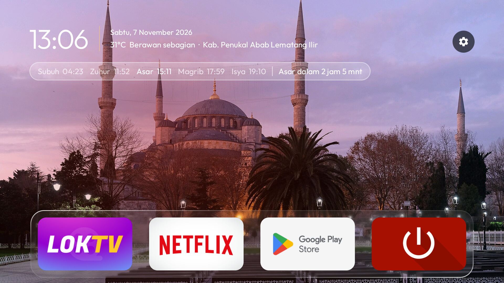

# Clear TV Islamic

<p><a>English</a> · <a href="docs/INSTALL.md">Step-by-step install guide</a> · <a href="docs/INSTALL.id.md">Panduan pemasangan</a></p>

**A calm, lightweight home screen for Android TV and Google TV, with Indonesian prayer times, local weather,
azan, Quran verses, and online mosque photos that rotate behind Home.**

Clear TV Islamic replaces a crowded TV home screen with a remote-friendly horizontal app row, smooth focus
animations, navigation sounds and a glass dock. Indonesian prayer times and local weather follow the TV's
location. Mosque photos rotate behind Home every three minutes while the TV is online. The Islamic screensaver has
its own downloaded mosque photos, prayer times, Hijri date and Quran verses. Optional setup tools can reduce
preinstalled clutter without root access. Home has no bundled offline wallpaper; local theme pictures are available
when you want a wallpaper that does not depend on an internet connection.


- **Indonesian prayer times** from myQuran, selected automatically from the TV's location, with the next prayer
  highlighted and a live countdown.
- **Weather beside the clock**, with current temperature, conditions and the detected city.
- **The azan** at every prayer, even while you watch YouTube or Netflix: full screen on Home, a band across the
  bottom over any other app, with the recitation of your choice (a different one for Subuh).
- **An Islamic screensaver**: a gold clock, a card of the day's prayer times and a verse of the Quran that changes.
- **Online mosque photos for Home** from the curated `themes/islamik/masjid.json` list, changing every three
  minutes. Photos stay in memory rather than being saved locally. The APK has no bundled offline wallpaper;
  the screensaver separately downloads its own mosque photos to local storage.
- **Light and clean**: ads, tracking and bloat switched off, and the TV clears its own caches every 15 days.
- **Navigation feedback**: a short SoundPool tick when focus moves between apps. The Islamic theme keeps the glass dock visible and hides the Wi-Fi pill and Inputs shortcut.
- **One horizontal app row**: browse installed apps with Left and Right; Up returns to the top bar. Favourite apps stay first, the focused tile enlarges, and its name appears above the tile.

**New to this? Follow the [step-by-step install guide](docs/INSTALL.md)**: no coding, no Android SDK, about
30 minutes. Built on [CleanYourTV](https://github.com/Gathin23/cleanyourtv) by Gathin (MIT).

<sub>Prayer times are from the myQuran API (Kemenag RI). Weather is from Open-Meteo.</sub>

## What you get

- **Keeps itself clean.** Every 15 days, while Home sits idle, the TV clears its app caches, where the Play
  Store leaves gigabytes of download leftovers that can make apps open to a blank screen. No computer needed,
  sign-ins and app data are never touched; the TV asks once to allow it.
- **Glass, like Apple's.** The dock's tray, the top-bar buttons and the menus show the picture behind them
  softened, with a shine along their edges. Android 10 has no live blur, so the picture is blurred once each
  time it changes and the glass draws its patch of it.
- **One selection that glides.** Between apps it is a pane of glass with the app's shadow under it; on the top
  bar and in the menus it is dark. It glides and changes shape from one to the next, never jumps.
- **Clear app labels.** The focused app name appears at the top of its tile; other app labels and mosque photo captions stay hidden on Home.
- **Arrange your apps from the remote.** Hold OK on an app for a glass menu with **Move** and **App info**.
  Move picks the app up: it wiggles, the arrows carry it (into or out of the dock too) and the other apps
  slide aside; OK puts it down. The order is kept, and apps installed later join at the end.
- **Hide apps without uninstalling them.** Hold OK on an app and choose **Hide app**. To bring it back, hold OK
  on Settings and open **Hidden apps**, then choose the app to show again.
- **Comes back as you left it.** Back from an app, the app you left is still selected; pressing Home on Home
  goes to the first app. When Android has closed Home to free memory, it comes back whole in one frame,
  with no black screen and no half-built dock.
- **A clock screensaver.** A grey analog dial with a yellow-orange second hand that ticks, the time and
  date beneath, drifting a little each minute so nothing burns in.
- **Use your own wallpapers** by setting `"masjid_home": false`: add `wallpaper.jpg` or images in a theme's
  `wallpapers/` folder. The launcher downsamples them off the main thread and can rotate them on a theme interval.

| | |
|---|---|
|  |  |
| *Inputs, in glass* | *The Islamic screensaver* |
|  |  |
| *The azan screen at prayer time, on Home* | *The azan over any other app, even YouTube or Netflix* |

Still light: on a Xiaomi Mi TV with 1.8 GB of RAM the launcher uses about 80–100 MB and stays there over hours
of use, one wallpaper bitmap is kept in memory at a time, and nothing runs while you are inside an app, except
the azan at prayer time.

## Setting it up

**The easy way, with no coding:** the [step-by-step install guide](docs/INSTALL.md) installs the ready-made
`dist/clear-tv-islamic.apk`, so you need only Python, not Java or the Android SDK.

**Using an AI coding agent** (Claude Code, Codex, Cursor, Copilot…)? Point it at this repository and ask it to
set up your TV. [AGENTS.md](AGENTS.md) tells any agent, even a small model, how to do it safely on any Android TV or Google
TV: it first works out which Clear TV Islamic your TV can run (the Android launcher, the LG webOS app, or neither on
Samsung and Roku), then
asks before each change, backs up first, never uninstalls, and checks each step with you as it goes.

The full step-by-step guide for debloating and installing is in
[docs/CLEANYOURTV-README.md](docs/CLEANYOURTV-README.md), and [PROMPT.md](PROMPT.md) lets a coding assistant do
it for you. In short:

```bash
python3 -m venv tools/venv && tools/venv/bin/pip install -r tools/requirements.txt
export TV_HOST=192.168.1.50                                   # your TV's IP address
tools/disable.sh examples/<your tv>/debloat.txt               # debloat
launcher/build-and-install.sh                                 # build the launcher and make it Home
# or, without building: APK=dist/clear-tv-islamic.apk launcher/build-and-install.sh
tools/theme.sh themes/<your theme>                            # push your settings and wallpapers
```

Clear TV Islamic clears the TV's caches by itself every 15 days ([how](docs/cache-clean.md)). To clean several TVs
from one computer instead, [`tools/cache-clean.sh`](docs/cache-clean.md) finds the TVs on your network and
clears their caches, leaving sign-ins and app data untouched.

## Prayer times and azan


- **Prayer times on Home:** a glass row under the clock with today's five prayers (Subuh, Zuhur,
  Asar, Magrib, Isya), the next one highlighted and a countdown ("Asar dalam 12 mnt"). The city is resolved
  from Android's current location; daily schedules come from the [myQuran API](https://api.myquran.com/doc),
  sourced from Kemenag RI, and are cached on the TV.
- **Weather and location:** current temperature and conditions from [Open-Meteo](https://open-meteo.com/en/docs),
  beside the date and city name. The TV's Android location service selects the location while Home is open.
- **The Islamic screensaver:** a gold clock, the Indonesian and Hijri dates, a card of the prayer times with the next
  one framed in gold, and a verse of the Quran with its translation that changes every 3 minutes. Arabic text in
  the Uthmani script and the translation of the Indonesian Ministry of Religious Affairs (Kemenag RI), via
  quran.com (`launcher/app/src/main/res/raw/ayat.json`).
- **Mosque photos:** Home rotates photos from
  [themes/islamik/masjid.json](themes/islamik/masjid.json) every three minutes. Online Home photos stay in
  memory rather than local storage; the APK has no bundled offline fallback. The screensaver has its own
  downloaded photo collection. Photo credits and licence details are included in the list.
- **The azan:** at every prayer time, on the screensaver or on Home, the azan screen comes up and `azan.mp3` plays
  (`azan-subuh.mp3` for Subuh). **In any other app** (YouTube, Netflix, Live TV) a band slides up across the lower
  third of the screen with the prayer's name, the video underneath pauses and the azan plays. Any button on the
  remote stops it. `"azan_over_apps": false` keeps the azan to Home and the screensaver.

**How:** install as usual, then make a theme folder with a `config.json`
([themes/islamik](themes/islamik/config.json) is ready to copy):

```json
{
  "auto_location": true,
  "weather": true,
  "download_masjid": true,
  "download_azan": true,
  "show_network_pill": false,
  "show_inputs": false,
  "show_dock_tray": true,
  "azan": true
}
```

The launcher uses the TV's Android location to select a city automatically. [themes/islamik](themes/islamik)
comes with an azan (`azan.mp3`, by
Ustaz Asri Ibrahim of Rabbani) and a Subuh azan (`azan-subuh.mp3`); replace either with a recording of your own,
keeping the name. If either audio file is missing, `download_azan` fetches the default recording and saves it on
the TV; existing custom files are not replaced. Then send the theme to the TV:

```bash
TV_HOST=<tv ip> tools/theme.sh <theme folder>
```

Without an audio file the azan screen shows silently for 90 seconds. `"azan": false` turns the azan off.
Set `"auto_location": false` to disable location-based prayer times, or `"weather": false` to hide weather.

## Which TVs work

Android TV and Google TV, Android 8 or newer, on the TV or on a box plugged into any TV.
[docs/DEVICES.md](docs/DEVICES.md) lists every tested model and how far each was tested: end to end with
Clear TV Islamic, with the original launcher, or debloat only, plus what is expected to work and what cannot.

## LG and Samsung TVs

LG TVs run webOS and Samsung TVs run Tizen; neither can run Android apps, and neither lets any app replace its
home screen or the Home button. For the full Clear TV Islamic, plug in a Google TV or Android TV box (Chromecast with
Google TV, Xiaomi Mi Box, NVIDIA Shield): the TV becomes the screen and Clear TV Islamic is Home. On LG, a version you
open as an app is in preview in [webos/](webos/README.md).

## Custom wallpapers and limited connectivity

Home's curated mosque photos need an internet connection, and the APK does not include an offline fallback. To use
local theme pictures behind Home, set `masjid_home` to `false`. You can reduce network use by turning off location,
weather, screensaver photo downloads, and azan downloads:

```json
{
  "masjid_home": false,
  "auto_location": false,
  "weather": false,
  "download_masjid": false,
  "download_azan": false,
  "show_network_pill": false
}
```

Then include a local `wallpaper.jpg` or `wallpapers/` folder in the theme and send it with `tools/theme.sh`.
Prayer times and weather refresh when the TV has internet and location access; previously cached data may remain
available between refreshes. Keep azan enabled with local audio files, or set `azan` to `false` if you do not want
it in this setup. All keys are listed in [themes/README.md](themes/README.md).

## Credits and licence

- Built on [CleanYourTV](https://github.com/Gathin23/cleanyourtv) © 2026 Gathin, MIT licence — see
  [LICENSE](LICENSE). Its debloat lists, tools and launcher are the foundation of this project.
- The Outfit typeface is under the SIL Open Font License (`launcher/FONT-LICENSE-OFL.txt`).
- The Inputs icon is from Google's Material Icons (Apache 2.0).
- The Android Home and screensaver mosque photos come from Wikimedia Commons; each photo is credited in
  [themes/islamik/masjid.json](themes/islamik/masjid.json). The LG webOS preview still uses Bing's daily-place images.
- Gotham, used in the original promo pictures only, is a Hoefler&Co. typeface and is not part of this repository.
- Prayer times from the [myQuran API](https://api.myquran.com/doc), sourced from Kemenag RI. Weather from
  [Open-Meteo](https://open-meteo.com/en/docs). Quran text (Uthmani, Hafs) and the Kemenag RI
  translation via [quran.com](https://quran.com). Mosque photos from Wikimedia Commons, each credited on screen and
  in [themes/islamik/masjid.json](themes/islamik/masjid.json).
- The azan recordings in [themes/islamik](themes/islamik): Ustaz Asri Ibrahim (Rabbani), and "Adzan Subuh Merdu".
  The repository owner states they are free to share; a rights holder who disagrees can open an issue and they
  will be removed.
